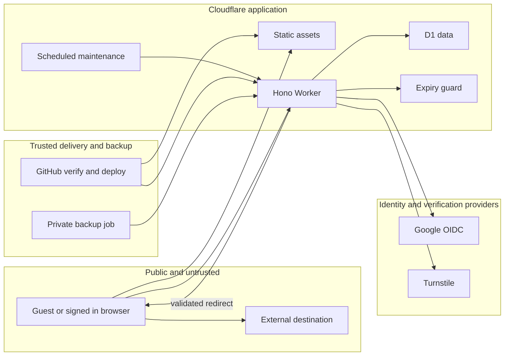

# oh.io.vn threat model

## Executive summary

Ứng dụng rút gọn link công khai có ba nhóm quyền: khách, tài khoản Google và
admin. Tài sản quan trọng là quyền sửa đích link, danh tính/phiên, dữ liệu quản trị,
backup và ngân sách Cloudflare/D1. Review source và kiểm thử local xác nhận hai
bypass chính sách đích đã sửa. Chưa xác minh được bypass auth/ownership, SQLi,
XSS hay lộ secret trong phạm vi đã kiểm tra. Mô hình dưới đây liệt kê cả những
mối đe dọa đang được kiểm soát, không phải danh sách lỗ hổng đã chứng minh.

## Scope and assumptions

- Phạm vi: working tree trên `main` nền `ac4aa3a`, ngày 18/10/2026. `src/worker`,
  `src/shared`, `src/web`, migrations, config, workflow, build và backup scripts.
- Source/config là căn cứ chính. `ARCHITECTURE.md` ghi rõ là đề xuất ban đầu và
  chưa phản ánh đầy đủ Durable Object hoặc admin directory đã triển khai.
- Giả định Cloudflare terminate TLS và gán CF-Connecting-IP đúng. Không giả định
  kẻ tấn công đã có quyền deploy, D1 binding, Google signing key hoặc secret store.
- Khách và người dùng Google độc hại có thể gửi request tùy ý. Không tin UI,
  query/body, cookie tự khai, tên hiển thị, URL đích hoặc header do client tự gửi.
- Ngoài phạm vi: production exploitation, dữ liệu thật, DNS/WAF/account audit,
  xâm nhập third party và repository backup riêng. Chỉ dùng D1 local/dữ liệu giả.
- Chưa rõ và có thể đổi mức rủi ro: quy mô traffic/NAT, quyền token thật,
  branch protection, quyền/retention repo backup, WAF và các subdomain cùng domain.
  Không cần các giả định này để sửa hai bypass đã tái hiện.

## System model

### Primary components

- Vite multipage + generator: HTML, CSS, TypeScript; static assets do Cloudflare
  phục vụ. `scripts/generate-pages.mjs`, `public/_headers`, `wrangler.jsonc.assets`.
- Hono Worker: router, quyền, JSON API và redirect. `src/worker/index.ts`.
- Google OIDC + Turnstile: identity và chống tự động tạo link.
  `src/worker/auth.ts`, `src/worker/security.ts:verifyTurnstile`.
- D1: users, sessions, links, creation_events, analytics, blocked_targets, policy,
  admin_audit. Prepared statements, quota/rename triggers. `migrations/0001*` tới `0004*`.
- Durable Object ExpiryGuard giữ trạng thái sự cố, chỉ truy cập qua binding.
  `src/worker/guard.ts`, `src/worker/service.ts:incidentHold`.
- Cron giám sát và dọn dữ liệu, dùng API Cloudflare cố định với token riêng.
  `src/worker/monitor.ts`, `src/worker/service.ts:maintenance`.
- GitHub CI build/deploy, workflow backup riêng xuất dữ liệu đã xác thực rồi mã
  hóa AES-GCM. `.github/workflows/ci.yml`, `scripts/backup.mjs`, `scripts/restore.mjs`.

### Data flows and trust boundaries

- Internet → static assets: HTTPS, cùng HTML cho khách/member, không chứa dữ liệu
  account. CSP, nosniff, frame protection từ `public/_headers`.
- Browser → API: HTTPS JSON/cookie, giới hạn body 8 KiB, HMAC network rate key
  trước D1, Origin/CSRF khi ghi, session/hash và role/ownership tại Worker.
- Browser → Google → callback: code + encrypted state cookie. Google token
  exchange cố định, PKCE/nonce/state và JOSE RS256 issuer/audience/exp validation.
- Worker → Turnstile: HTTPS endpoint cố định, timeout, hostname/action, fail closed.
- Worker → D1: binding tin cậy, prepared SQL. Dữ liệu đầu vào không được trở
  thành table/column identifier tùy ý. Transaction/trigger giữ quota và rename.
- Slug → Worker → Location response: target HTTP(S) đã validate, trạng thái/thời
  hạn/blocklist kiểm tra lại. Browser mới truy cập đích, Worker không tải đích.
- Cron → Cloudflare metrics / D1 / guard: endpoint từ code + deployment config,
  token riêng, timeout. Guard chỉ có binding, không phải public admin endpoint.
- Backup job → API → encrypted private artifact: bearer credential, giới hạn
  rows/bytes, không sessions/network hash, AES-GCM trước artifact upload.
- GitHub main → verify → production: actions SHA-pinned, dependency/secret/test
  gates, environment-scoped deploy credential, exact SHA artifact, concurrency.

#### Diagram

## Assets and security objectives

| Asset | Why it matters | Security objective |
| --- | --- | --- |
| Session/hash, Google sub, name/email | Tài khoản và dữ liệu cá nhân | C, I |
| Link owner/target/slug/expiry | Ngăn người khác đổi đích hoặc cướp mã | I, A |
| Admin role, policy, blocklist | Quyền kiểm soát dịch vụ | I, A |
| Analytics | Chỉ chủ link/admin xem, không lộ session | C, I |
| D1/Worker capacity | Duy trì chuyển hướng và quản lý | A |
| Provider/deploy/backup credentials | Ranh giới quyền hạ tầng | C, I |
| Backup | Khôi phục dữ liệu mà không lộ người dùng | C, I, A |

## Attacker model

### Capabilities

Khách tự gửi HTTP/query/body và cookie giả, mở link công khai, tạo link khi qua
Turnstile/quota. Người dùng ác ý có phiên hợp lệ và dữ liệu link của mình. Có thể
đặt nội dung HTML trong tên ghi nhớ, URL và tên hiển thị. PR contributor có thể
đề xuất code/dependency nhưng không mặc nhiên có quyền merge/deploy.

### Non-capabilities

Không giả định có Google signing key, HMAC secret, bearer backup, quyền D1 trực
tiếp, remote code execution, Cloudflare account hoặc quyền admin. Không giả định
CORS/robots/ẩn nút là access control. Header CF chỉ tin trong biên Cloudflare.

## Entry points and attack surfaces

| Surface | How reached | Trust boundary | Notes | Evidence |
| --- | --- | --- | --- | --- |
| Login/callback | Public GET | Browser/Google → Worker | State, PKCE, nonce, token checks | `auth.ts` |
| Create/config/me | Public API | Browser → Worker | Quota, Turnstile, bounded body, throttles | `index.ts`, `security.ts` |
| Edit/delete/stats | Session API | Owner → D1 objects | Owner predicate, active state, CSRF | `index.ts`, `link-management.ts` |
| Admin directory/actions | Session API | Admin → all accounts/links | Server admin check, shared edit validation | `admin-directory.ts`, `index.ts` |
| Slug | Public GET/HEAD | Public → stored target | Moderation/expiry then 302 | `index.ts`, `service.ts` |
| DOM | API data → render | Untrusted strings → browser parser | esc/textContent, fixed icon registry | `src/web/main.ts` |
| Backup/ack | Bearer API | Private job → D1 | Own auth before data read/write | `index.ts`, `backup.mjs` |
| Build/deploy/restore | Maintainer workflow/CLI | Git/npm → production artifacts | SHA pins, scans, dry-run, offline restore | CI, `restore.mjs` |

## Top abuse paths

1. Dẫn đến nội dung đã chặn → thay fragment/hostname → tạo/sửa/mở link → bypass
   moderation. Đã tái hiện local và sửa (SEC-001/002).
2. Chiếm link người khác → đổi slug/path hoặc gửi owner_id/admin trong JSON →
   đọc/sửa/xóa dữ liệu ngoài quyền. Owner/admin predicates và allowlist chặn,
   regression tests kiểm tra, chưa tìm thấy bypass.
3. Chiếm phiên → callback giả/token sai hoặc cross-site write → login/CSRF
   attack. State/PKCE/nonce/JOSE và Origin/CSRF kiểm soát, local tests đạt.
4. Stored XSS → đặt markup trong label/name → admin/chủ link mở danh sách →
   thực thi JS. Escaping hiện có chặn, browser test không dựa riêng vào CSP.
5. Cạn ngân sách → gửi nhiều API read hoặc invalid write → D1 reads trước guard.
   Đã đưa throttle trước D1. Chưa load-test và không tuyên bố chống DDoS hoàn toàn.
6. Lộ backup → gọi internal API hoặc lấy artifact → đọc users/targets.
   Bearer gate, private encrypted artifact và giới hạn export kiểm soát.
7. Chuỗi cung ứng → đổi action tag/dependency hoặc đưa secret vào Git → build
   thực thi mã/đẩy artifact độc hại. SHA/checksum pins và verify gates giảm rủi ro,
   branch protection/credential scope production vẫn chưa được kiểm tra.

## Threat model table

| Threat ID | Threat source | Prerequisites | Threat action | Impact | Impacted assets | Existing controls (evidence) | Gaps | Recommended mitigations | Detection ideas | Likelihood | Impact severity | Priority |
| --- | --- | --- | --- | --- | --- | --- | --- | --- | --- | --- | --- | --- |
| TM-001 | Guest/member | Tạo link hoặc có link để sửa | Biến thể đích vượt moderation | Nội dung bị chặn vẫn mở | Policy, trust | `blocked`, `targetValue` | Hai normalization bypass trước sửa | Bản vá SEC-001/002 và tests | Theo dõi block rejects/báo cáo vi phạm | Medium trước sửa | Medium | medium |
| TM-002 | Member | Biết slug/ID người khác | IDOR, mass assignment | Sửa đích/lộ stats | Links, analytics | Owner WHERE, admin middleware | Chưa thấy bypass, cần giữ phủ route mới | Server checks cho mọi route | Regression owner/other/admin | Low theo test hiện có | High | medium |
| TM-003 | External client | Gửi OAuth/cookie/cross-site request | Giả identity hoặc CSRF | Chiếm tài khoản/thao tác trái phép | Sessions, role | `auth.ts`, `checkWrite` | Provider config ngoài phạm vi | Giữ JOSE/state/nonce/PKCE/cookie | Local token matrix, 401/403 trend | Low theo test hiện có | High | medium |
| TM-004 | Malicious content | Label/name được render | HTML/DOM XSS | Thao tác bằng quyền nạn nhân | Browser/account | esc/textContent + CSP | UI sinks cần review khi thay đổi | Browser escaping+CSP tests | CSP violation/DOM regression | Low theo test hiện có | High | medium |
| TM-005 | Bot network | Public endpoints | Tốn D1/Worker budget | Mất availability | Capacity, redirects | Quota, Turnstile, API throttle | Distributed attacks, NAT tradeoff chưa đo | SEC-003, theo dõi và điều chỉnh có bằng chứng | 429, D1 usage, heartbeat | Medium | Medium | medium |
| TM-006 | External client/token thief | Backup token/artifact access | Export/đánh cắp backup | Lộ PII/targets | Backup, users | Bearer auth, AES-GCM | Secret scope/retention thật chưa kiểm tra | Least privilege, quy trình revoke khi lộ | Backup failures, artifact permissions | Low nếu secret được giữ | High | medium |
| TM-007 | Supply chain/contributor | Dependency/action hoặc quyền merge | Code độc hại trong build/deploy | Chiếm runtime/secrets | All runtime assets | Locked deps, SHA pins, verify gate | Không thể chứng minh mọi package an toàn | SEC-004, review deps/branch protections | Audit, Gitleaks, code review | Low theo scan hiện có | High | medium |

## Criticality calibration

- Critical: thực thi mã với quyền deploy hoặc export toàn bộ dữ liệu không cần
  auth, vượt mọi ranh giới. Đây là ví dụ tác động, không phải phát hiện đã có.
- High: người dùng thường sửa link của người khác, giả session/admin hoặc stored
  XSS thực thi trong phiên admin. Chưa xác minh các đường này ở lượt review.
- Medium: bypass moderation/đích như SEC-001/002, hoặc giảm availability có điều
  kiện nhưng không chứng minh chiếm quyền/dữ liệu toàn hệ thống.
- Low: giảm bề mặt supply-chain bằng pin SHA, đưa throttle sớm, cải thiện CI
  prevention khi chưa có bằng chứng exploitation hay compromise hiện hữu.

## Focus paths for security review

| Path | Why it matters | Related threats |
| --- | --- | --- |
| `src/shared/rules.ts`, `src/worker/service.ts` | Canonicalization, moderation, expiry | TM-001, TM-005 |
| `src/worker/index.ts` | Middleware ordering, ownership, admin, backup, redirects | TM-001, TM-002, TM-003, TM-005, TM-006 |
| `src/worker/auth.ts`, `security.ts` | Identity, session, CSRF, body, Turnstile | TM-002, TM-003 |
| `src/worker/admin-directory.ts`, `link-management.ts` | Cross-account privilege boundaries | TM-002 |
| `src/web/main.ts`, `public/_headers` | DOM sinks and browser policy | TM-004 |
| `migrations/` | Atomic quota, rename/ownership integrity | TM-002, TM-005 |
| `scripts/backup.mjs`, `restore.mjs` | Private export, encryption, offline restore | TM-006 |
| `.github/workflows/ci.yml`, lockfile | Build/deploy trust | TM-007 |

Kết quả cụ thể và các giới hạn kiểm chứng nằm trong báo cáo bảo mật đi kèm.
Không dùng priority của threat model để gọi mọi threat là vulnerability đã có.
